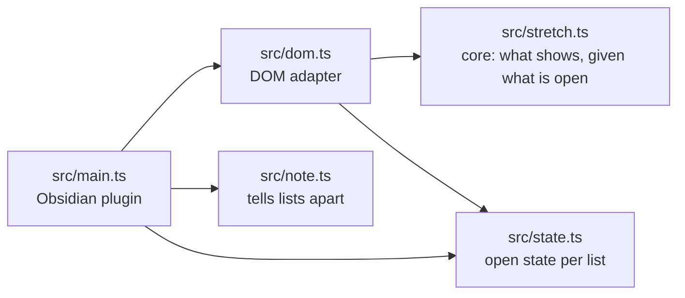
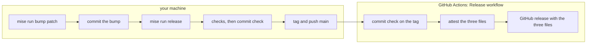

# Developing Stretch

Notes on building, testing and releasing the plugin. For what the plugin does and how to use it,
see the [README](README.md).

## Prerequisites

- Node and npm. `mise install` installs the Node version pinned in `mise.toml`, and dependencies
  are pinned in `package-lock.json`.
- [mise](https://mise.jdx.dev) for the tasks below. Run `mise trust` once after cloning.
- `jq`, used by the release tasks, and [gh](https://cli.github.com), logged in, to follow and
  repair releases.
- Obsidian 1.14.4 or later on desktop, the `minAppVersion` in `manifest.json`.

## Layout

The logic lives in a pure, tested core. The DOM and Obsidian are thin adapters around it.



- `src/stretch.ts` decides which nodes show, in what order, given what the reader has opened.
- `src/state.ts` keeps what is open for one list, shared by every view of it.
- `src/note.ts` tells lists apart, so each keeps its own open state.
- `src/dom.ts` reads Obsidian's rendered list into a tree and draws it as a paragraph. It uses
  Obsidian's DOM helpers, `createEl` and `createSpan`, which the tests install in jsdom.
- `src/main.ts` registers the Markdown post-processor and wires the rest together.

Each module has a test file of the same name under `tests/`.

## Tasks

```
mise run              # list the tasks
mise run cc           # commit check: clean, npm ci, typecheck, lint, test, build
mise run clean        # remove the built main.js
mise run bump patch   # bump the version: major, minor or patch
mise run release      # tag and push the version; GitHub Actions publishes the release
```

Run `mise run cc` before committing. The npm scripts underneath also work on their own:

```
npm test                # vitest under jsdom
npm run typecheck
npm run lint            # Obsidian's review rules over src
npm run build           # production main.js
npm run dev             # rebuild main.js on change, with an inline source map
npm run install:vault   # copy the plugin into a vault
```

The lint runs `eslint-plugin-obsidianmd`'s recommended rules, the ones Obsidian's plugin review
runs, and fails on warnings too, so a finding there shows up before submission. Its type-checked
rules need typescript-eslint, which supports TypeScript up to 6.0, so the project stays on
TypeScript 6.0 until it supports 7.

`npm run dev` writes a development `main.js` with a source map. Releases are built by GitHub
Actions from the tagged commit, so a local build is never released.

## Continuous integration

GitHub Actions runs `mise run commit-check` on every push to `main` and every pull request, with
the Node version from `mise.toml`. Besides the build and the tests, it catches versions that
disagree:

- `npm ci` fails if `package-lock.json` does not match the dependencies in `package.json`.
- `tests/versions.test.ts` fails if `package.json`, `package-lock.json` and `manifest.json` carry
  different plugin versions.
- The same test fails if the `obsidian` API package is newer than the manifest's
  `minAppVersion`, since the plugin could then use API that the oldest supported Obsidian lacks.

## Trying it in Obsidian

### In your own vault

```
npm run build
npm run install:vault
```

This copies `main.js`, `manifest.json` and `styles.css` into `.obsidian/plugins/stretch` of
`~/Documents/Notes`, or of the vault named by `VAULT`. The first time, switch Stretch on under
Settings, Community plugins. After that, reload Obsidian or toggle the plugin off and on to pick
up a new build.

Then open a note with a `> [!stretch]` callout in reading view.

### In an isolated Obsidian

To test without touching your vault or the Obsidian you have open, run a second Obsidian with
its own profile folder and a throwaway vault. The debugging port lets a tool such as
`agent-browser` drive it.

1. Make a vault folder with the plugin files in `.obsidian/plugins/stretch`, a
   `.obsidian/community-plugins.json` holding `["stretch"]`, and a test note.
2. Make a profile folder holding an `obsidian.json` that lists the vault as open:

   ```json
   {"vaults":{"a1b2c3d4e5f60718":{"path":"/absolute/path/to/vault","ts":0,"open":true}}}
   ```

3. Launch Obsidian with that profile and a debugging port:

   ```
   /Applications/Obsidian.app/Contents/MacOS/Obsidian \
     --user-data-dir=/absolute/path/to/profile --remote-debugging-port=9333
   ```

4. A new profile may start on the version bundled with the app and download the latest. If it
   is older than `minAppVersion`, quit and launch again to run the update.
5. Obsidian asks whether you trust the vault's author. Trust it to turn the plugin on.

With `agent-browser connect 9333`, the page's `app` object is reachable through
`agent-browser eval`, and clicks and key presses go to the real reading view.

## Releasing

Obsidian finds a plugin's release by the version in `manifest.json`. The Git tag is that version
exactly, with no `v` prefix, and the release carries `main.js`, `manifest.json` and `styles.css`.



1. Bump the version. This updates `package.json`, `package-lock.json` and `manifest.json`
   together.

   ```
   mise run bump patch
   ```

2. If the release needs a newer Obsidian, raise `minAppVersion` in `manifest.json` by hand.
3. Commit the bump on `main`.
4. Release. GitHub writes the notes unless you pass a file of your own:

   ```
   mise run release
   mise run release --notes notes.md
   ```

The release task stops before tagging if:

- the tag already exists, locally or on GitHub;
- `package.json` and `manifest.json` disagree on the version;
- the current branch is not `main`;
- the working tree has uncommitted changes.

It then runs the commit check, tags the commit, and pushes `main` and the tag. A notes file
goes into the tag's message, which makes it an annotated tag.

Pushing the tag starts the Release workflow, `.github/workflows/release.yml`. It checks that the
tag matches the version in `manifest.json` and runs the commit check on the tagged commit. Then
it attests `main.js`, `manifest.json` and `styles.css` and creates the release with them. The
notes come from the tag's message, or GitHub writes them when the tag has none. Follow it with:

```
gh run list --workflow release.yml
gh run watch
```

The attestations let anyone check that a release file was built from this repository by its
workflow:

```
gh release download 0.1.2 --pattern main.js
gh attestation verify main.js --repo channingwalton/obsidian-stretch
```

### If a release goes wrong

A failure before the tag is made leaves nothing to undo. If the tag was pushed but the workflow
failed, fix the cause and run it again from the Actions tab, or with `gh run rerun`. A rerun
builds the same tagged commit, so a fix that needs a code change needs a new version instead.

To withdraw a release entirely, delete it and its tag on GitHub, then delete the local tag:

```
gh release delete 0.1.2 --cleanup-tag
git tag -d 0.1.2
```
