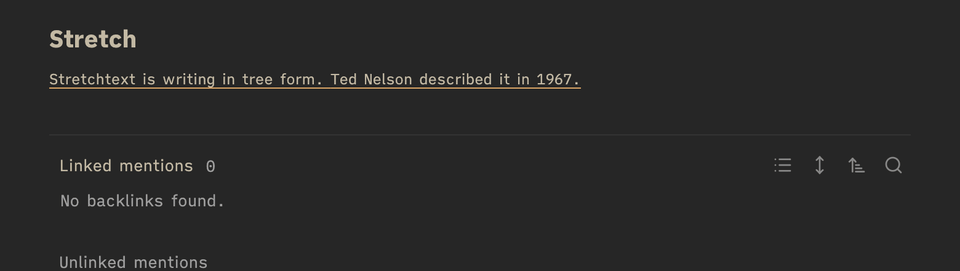

# Stretch

[](https://github.com/channingwalton/obsidian-stretch/actions/workflows/ci.yml)

[Stretchtext](https://en.wikipedia.org/wiki/Stretchtext) for Obsidian. A nested bullet list in a stretch callout reads as a paragraph.
Top-level bullets are what you see first. Click a sentence that can open, or the `»` after it, and its
children appear after it, in place; click `«` to close them again. Each click opens one level.
The marks are buttons, so Tab reaches them and Enter or Space works them.



The markup is just an outline in a callout, so lists outside the callout stay ordinary lists, and
elsewhere, such as GitHub, the note shows a quote that starts `[!stretch]` and holds a nested list.

## Use

Write nested bullets where every bullet is a sentence that stands on its own, inside a `stretch`
callout:

```markdown
> [!stretch]
> - The build fails on a stale cache.
> 	- The CI cache is keyed only by `package.json`, so a lockfile change leaves it stale.
> 		- About one run in five hits it.
> - The fix is to key the cache on the lockfile.
```

That renders as "The build fails on a stale cache. The fix is to key the cache on the lockfile."
with the first sentence underlined. Click it and the second level opens after it. The callout's
box and title are hidden, so it reads as a paragraph of the note. Each bullet list in the callout
becomes a paragraph of its own; anything else in it, such as a line of text, stays as it is.

In Live Preview the paragraph works the same way until you edit it: put the cursor in the callout,
or use the `</>` button that appears on hover, to see the outline.

What the reader has opened is remembered for the session, per note, not saved. It is kept by the
list's position in the note, so editing the list while reading it may move or drop what was open.
Reading view and Live Preview each keep their own.

## Limits

- Paper cannot be clicked, so Export to PDF prints the note's own stretch callouts as paragraphs
  with every level open. A stretch callout in a note embedded in it prints only its top level.
- Only a stretch callout at the top level of a note is drawn as stretchtext. One inside a quote,
  another callout or a list is left as it is.
- The callout's title is hidden, a custom one too, and a folded callout, `> [!stretch]-`, shows
  its paragraph all the same.
- A task checkbox in a stretch list shows its state but cannot be ticked there; Obsidian's handler
  needs the list item the plugin replaced.
- Bullets are meant to hold sentences. A numbered sublist stays inside its sentence, unopened. A
  code block, table or quote inside a bullet is kept but breaks the paragraph's flow.

## Develop

```
npm test             # vitest: the core, the DOM adapter and the print styles, under jsdom
npm run typecheck
npm run lint         # Obsidian's review rules over src
npm run build        # main.js
npm run install:vault   # copy into ~/Documents/Notes/.obsidian/plugins/stretch (or $VAULT)
```

`src/stretch.ts` is the core: which nodes show, given what is open. `src/dom.ts` reads Obsidian's
rendered list and draws the paragraph. `src/main.ts` is the Obsidian plugin, kept thin.
